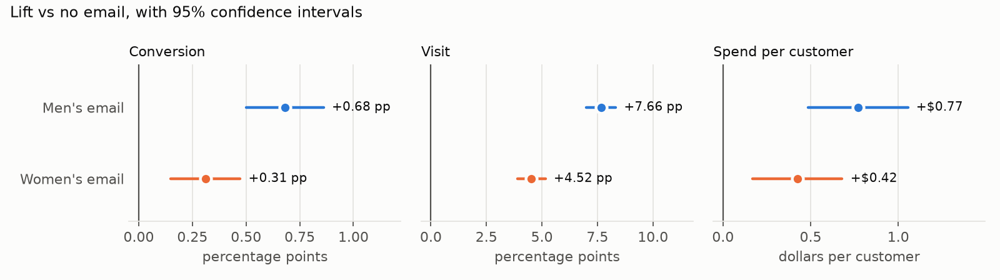
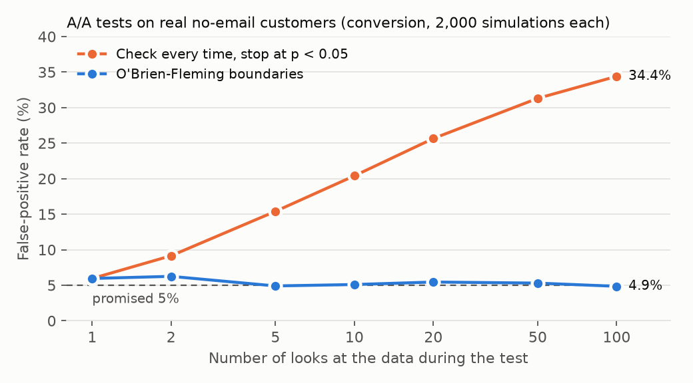

# A/B Testing an Email Campaign: from Power Analysis to Ship Decision

[](https://github.com/Loya-ar/ab-testing-email-experiment/actions/workflows/ci.yml)

A complete, tested analysis of a real randomised experiment, run the way a bank's analytics team
would evaluate a marketing campaign (a card offer, a deposit promotion, an app nudge). It covers
design and power, sanity checks, effect estimates with corrections, variance reduction, the
classic pitfalls, and a one-page decision memo.

> **About the data:** this is **not bank data**. It is Kevin Hillstrom's public
> [MineThatData E-Mail Analytics Challenge](http://www.minethatdata.com/) dataset: 64,000 customers
> of a US retailer, randomised in **2008** into a men's-merchandise email, a women's-merchandise
> email, or no email, with visits, purchases and spend tracked for two weeks. The method carries
> over to banking; the specific numbers don't.

**Decision: ship the men's email; send the women's email to a targeted follow-up test.**
[Read the decision memo →](docs/decision_memo.md)



## Contents

- [Results at a glance](#results-at-a-glance)
- [The analysis, step by step](#the-analysis-step-by-step)
- [What this project shows (and what it doesn't)](#what-this-project-shows-and-what-it-doesnt)
- [Run it](#run-it)
- [Repository layout](#repository-layout)
- [Tests and CI](#tests-and-ci)

## Results at a glance

| Metric (2 weeks) | No email | Men's email | Women's email |
|---|---|---|---|
| **Conversion (primary)** | 0.573% | 1.253% | 0.884% |
| Lift vs no email (95% CI) | — | **+0.68 pp** (+0.50, +0.86) | **+0.31 pp** (+0.15, +0.47) |
| Relative lift (95% CI) | — | +119% (+77%, +171%) | +54% (+23%, +94%) |
| Holm-adjusted p | — | 3.0e-13 | 1.6e-4 |
| Visit rate | 10.62% | 18.28% | 15.14% |
| Spend per customer | $0.65 | $1.42 | $1.08 |
| Spend per buyer (guardrail) | $114.00 | $113.53 | $121.89 |

Every number in this README comes from the scripts in [`scripts/`](scripts/), whose full output is
in [`reports/`](reports/). CI reruns everything on the real data and fails if any report changes.

## The analysis, step by step

| Step | What it does | Key result | Details |
|---|---|---|---|
| 1. Data | Download with a SHA-256 check; row counts, data-quality checks | 64,000 rows, no missing values, 3 groups of ~21,300 | [`download_data.py`](scripts/download_data.py) |
| 2. Design | Hypotheses, primary/secondary/guardrail metrics, decision rule, power analysis | With ~21,300 per group, the smallest reliably detectable conversion lift is **43%**; a 10% lift would need ~346,000 per group | [design](docs/design.md) · [report](reports/02_power.md) |
| 3. Sanity checks | Sample-ratio mismatch (chi-square), pre-period balance (SMD), omnibus test | SRM p = 0.90; largest \|SMD\| = 0.014 across 11 features; omnibus p = 0.89 | [report](reports/03_sanity_checks.md) |
| 4. Main results | Two-proportion z-test with absolute and relative CIs; Welch's t-test plus a 10,000-resample bootstrap for skewed spend; Holm correction | Both emails lift conversion, visits and spend; spend per buyer unchanged | [report](reports/04_main_results.md) |
| 5. CUPED | Variance reduction using pre-period `history`, plus regression adjustment with all 11 features | **Under 0.5% variance reduction**: past spend barely predicts a 2-week purchase (ρ ≈ 0.03). A simulation confirms the code delivers the expected ρ² reduction when the covariate is strong | [report](reports/05_cuped.md) |
| 6a. Peeking | A/A simulation on the real no-email customers, checking repeatedly and stopping at the first p < 0.05 | False positives rise from ~5% to **34%** with 100 looks; O'Brien-Fleming boundaries keep it near 5% | [report](reports/06a_peeking.md) |
| 6b. Segments | 44 segment × email tests, labelled exploratory, with Holm and Benjamini-Hochberg corrections and heterogeneity tests | 32 significant raw, 17 after Holm; **no difference in lift between segments survives correction** | [report](reports/06b_segments.md) |
| 7. Decision | One-page memo: recommendation, value, risks, next steps | Ship the men's email with a holdout group | [memo](docs/decision_memo.md) |



## What this project shows (and what it doesn't)

**Shows:**

- How to plan a test before reading results: one primary metric, a decision rule, and an honest
  power analysis. That analysis showed this test can only detect big conversion lifts, because
  only about 6 in 1,000 customers buy.
- Checking the randomisation before trusting any outcome (SRM, balance, omnibus).
- Choosing the right interval for each metric: Wald and log risk-ratio CIs for rates, and
  Welch's test checked against a bootstrap for heavily skewed spend (skewness 20.6).
- Correcting for multiple comparisons, and keeping segment cuts clearly exploratory.
- When CUPED helps and when it doesn't, verified by simulation rather than assumed.
- Why "check the dashboard daily and stop when it's significant" is broken, shown on real data.

**Doesn't (and says so):**

- **It isn't bank data.** It is 2008 retail email data; banking metrics such as balances or card
  spend are far more stable over time, so CUPED would likely help much more there. That is an
  expectation, not something measured here.
- **Customer-annoyance guardrails are missing.** The data has no unsubscribes, complaints or
  opt-outs, which a real campaign would have to watch.
- **The spend-per-buyer guardrail is weak.** Only 122 control buyers means a CI of about ±$23.
- **The window is short.** Two weeks of outcomes say nothing about long-term value or email
  fatigue.
- **The plan wasn't fully blind.** The design was written after a data check that showed group
  means, and the [design doc](docs/design.md) says so. It sticks to standard choices so nothing
  is tuned to the result.

## Run it

Python 3.11. Free; no accounts or credentials needed.

```bash
python -m venv .venv
# Windows: .venv\Scripts\activate    macOS/Linux: source .venv/bin/activate
pip install -r requirements-dev.txt
python scripts/run_all.py   # downloads the data (4 MB, checksum verified), then runs every step (about 1 minute)
pytest                      # tests for the stats functions
```

The raw CSV isn't committed; [`scripts/download_data.py`](scripts/download_data.py) fetches it
from MineThatData and checks its size and SHA-256.

## Repository layout

```
src/abtest/
  power.py         sample size and minimum detectable effect
  checks.py        sample-ratio-mismatch test, standardized mean difference
  inference.py     two-proportion test, Welch, bootstrap, Holm, Benjamini-Hochberg, Cochran's Q
  cuped.py         CUPED theta and adjustment
  sequential.py    A/A peeking simulation, O'Brien-Fleming boundaries
scripts/           one script per step, plus run_all.py and make_figures.py
reports/           generated output of each step (committed, checked by CI)
docs/              design doc and decision memo
figures/           charts used in this README
tests/             pytest tests for every module in src/abtest
```

## Tests and CI

28 pytest tests check each function against an independent reference: statsmodels
(`proportions_ztest`, `confint_proportions_2indep`, `multipletests`, power solvers), SciPy
(`chisquare`, Welch `ttest_ind`), textbook values (3,841 per group for 10% → 12%; the published
O'Brien-Fleming constant of 2.04 for 5 looks), and simulations (CUPED's ρ² reduction and
unbiasedness; peeking inflation and its fix).

[GitHub Actions](.github/workflows/ci.yml) runs two jobs on every push:

1. **tests:** runs the pytest suite (synthetic data, no download).
2. **reproduce:** downloads the real data, reruns every step, and fails if any file in `reports/`
   differs from the committed version.

## Data source

Kevin Hillstrom, *MineThatData E-Mail Analytics and Data Mining Challenge*, March 2008,
http://www.minethatdata.com/. The data is freely available from the author's site and isn't
redistributed in this repository.
